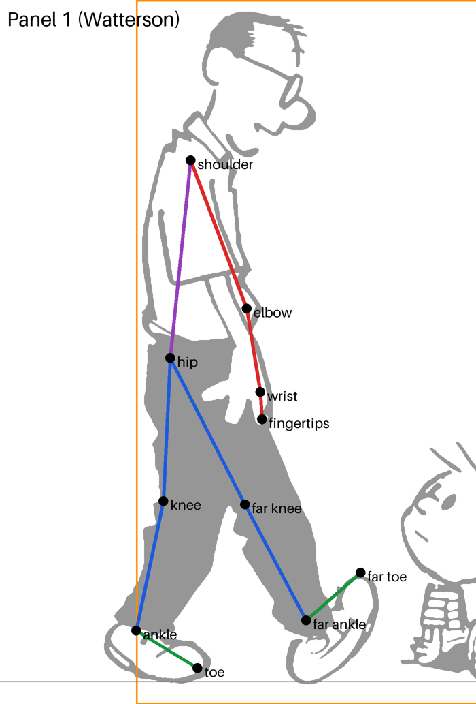
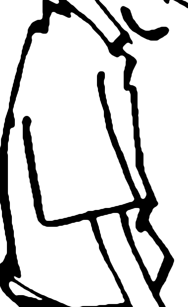
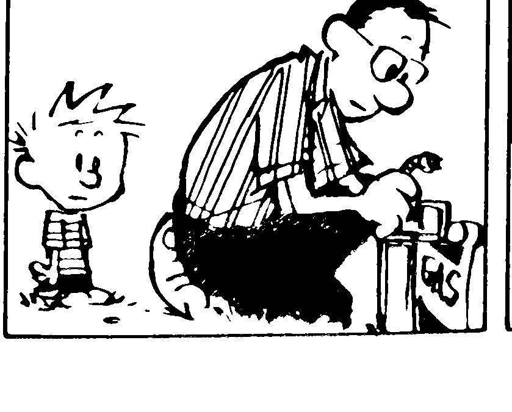
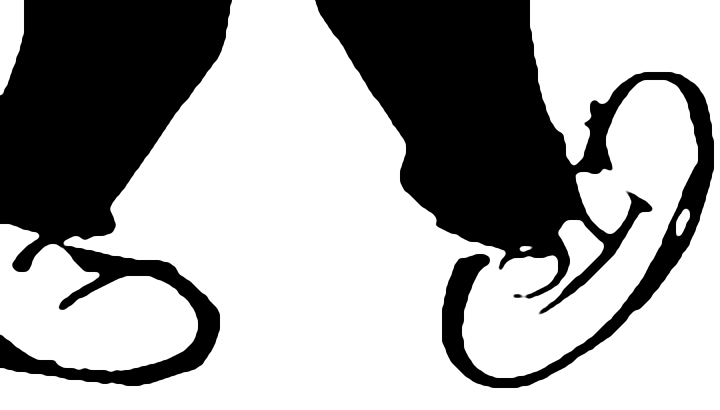
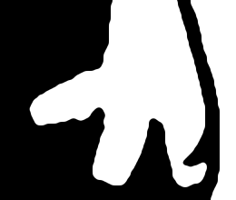
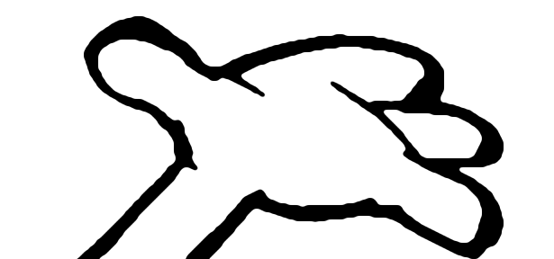
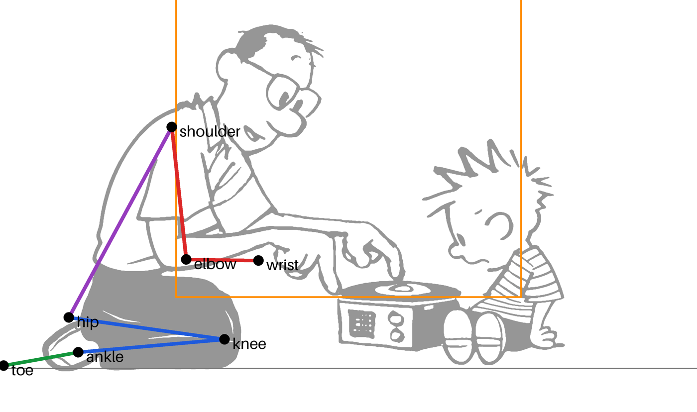
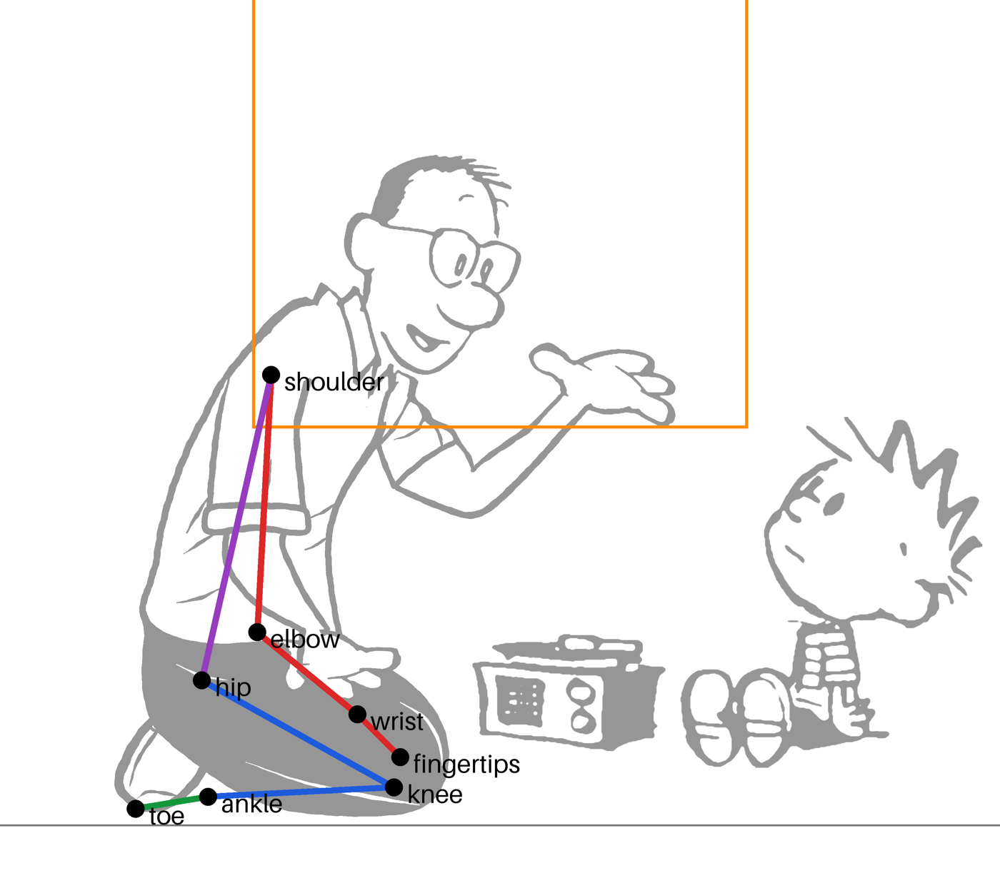

# Drawing Dad outside the scan: spec

This spec covers what gets drawn for Dad in the completed panels 2 and 3 (see
`assets/full-panels/`) beyond Watterson's scanned crops. It is written before
any drawing. Every rule points to a drawing of Watterson's own, and the
reference crops are in `docs/dad-spec/`. Poses are fixed as skeletons first
(`tools/extensions/reconstruction-v2/pose.py`) and approved before any ink.

## Units

All sizes are in Dad's **head widths** (Hw): the widest ink across his head
at the eyes, from the back of his head to his glasses.

| Panel | Head width |
|---|---|
| 1 (full figure) | 290 px |
| 2 | 493 px |
| 3 | 562 px |

## Proportions (measured on panel 1)

| Bone | Length |
|---|---|
| Shoulder to hip (torso) | 2.0 Hw |
| Shoulder to elbow | 1.6 Hw. The elbow is just above the waist when the arm hangs. |
| Elbow to wrist | 0.86 Hw as drawn in panel 1, where the forearm points slightly towards us. The forearms in panels 2 and 3 run 0.8–1.0 Hw. |
| Wrist to fingertips | about 0.3 Hw |
| Hip to knee | 1.45 Hw |
| Knee to ankle | 1.34 Hw |
| Shoe | 1.0 Hw long, 0.5 Hw tall |

A limb pointing towards or away from us is drawn shorter. `pose.check`
reports each bone against these lengths, allowing for foreshortening.

## Shirt sleeve

- A loose short sleeve. Its back edge comes off the shoulder, and its front
  edge starts as a free line at the armpit.
- It flares to a **plain, straight hem**, with no cuff or band. The hem rises
  slightly towards the front.
- The hem sits about 0.8 of the way from shoulder to elbow and is about 0.8
  Hw wide. The arm, about 0.3 Hw wide, comes out of the front part of the
  hem.
- Plan: reuse panel 1's sleeve itself, scaled and turned to the arm, rather
  than redrawing it.

## Trousers

- Flat solid black. The pose has to read from the **silhouette**.
- The outline changes direction at the seat, the knee and the ankle: a round
  knee pushes forward, and the cuff is visible where the leg ends at the
  shoe.
- Only a few white marks, short and tapered, and only at real folds: behind
  the knee, or where one leg overlaps another. No long decorative streaks.
- The thigh is about 0.6 Hw thick at the hip and 0.45 Hw at the knee. The
  shin is about 0.45 Hw at the knee, narrowing to 0.35 Hw at the ankle.

## Shoes

- White, with a heavy outline, a bulbous rounded toe and a sole line just
  inside the outline. About 1.0 by 0.5 Hw.
- The trouser cuff overlaps the top of the shoe at the heel.
- Plan: reuse panel 1's shoes, turned to the pose.

## Hands

 

- Four-fingered cartoon hands: a thumb and three fingers.
- Simple outlines. The gaps between fingers are drawn in from the
  fingertips, not all the way to the palm.
- The thumb is always visible and attached.
- Plan: reuse Watterson's hands (panel 3's gesturing hand, panel 1's hanging
  hand), posed to the skeleton.

## Line

- Outlines are about 17–20 px at the close-ups' scale, with tapered ends and
  a slight wobble.
- Everything is drawn with `ink.py` and thresholded to 1-bit, like the
  smoothed scan.

## Scope

Only the scanned crops and panel 4 are kept. Everything else of the earlier
extensions is redrawn to this spec:

- panel 1's left extension
- panel 2's back, near shoulder, sleeve and elbow, and its record player and
  Calvin's lower body
- panel 3's arrangement of the player and Calvin

## Poses (`pose.py`)

**Panel 2.** He sits back on his heels, leaning far forward to the record
player. Every bone is at Watterson's panel 1 length.
- The thigh lies on the shin, so the knee stands about 0.9 head widths tall.
  That is where the top of his knee is in the scan, turning down at the
  crop's bottom edge (x=1051).
- A full-length torso puts his seat well behind, over his heels. The panel
  widens to the left to fit his feet.
- The scan's own arm is shorter than panel 1's (upper arm 1.23 Hw, against
  1.6), so the near sleeve and shoulder follow the scan.
- Inking: a rounded seat resting on the heels, with a small notch where it
  meets them. A short foot shows behind, close to the floor, its heel
  visible under the seat. One decisive rounded knee, with the lower contour
  returning beneath it.

**Panel 3.** Kneeling, turned three-quarters towards us.
- The near upper arm hangs to an elbow just above the waist. A shorter
  forearm runs forward and down, so the hand rests on top of the knee, not
  at its joint.
- He is nearer us than Calvin, so he meets the floor lower in the panel.
- Inking: as panel 2, with some sign of the far leg (its knee or shoe).

**Calvin, panel 3.** He faces the player, as in panel 2: panel 1's body,
turned about the middle of his torso, under his unchanged head.

Codex reviewed the skeletons before any inking: 7/10 for panel 2 and 8/10
for panel 3, with the corrections above applied.

## Review loop

1. Render a sheet:
   - the panel at phone size
   - close-ups of the hand, knee, shoe and sleeve
   - the matching reference crops
2. Codex scores each part and names the three worst problems. Fix only those.
3. A second pass compares the new version against the best so far. Anything
   that is not better is thrown away.
4. Show the user a version only when every part scores at least 7/10, or when
   progress has stopped, saying which.
