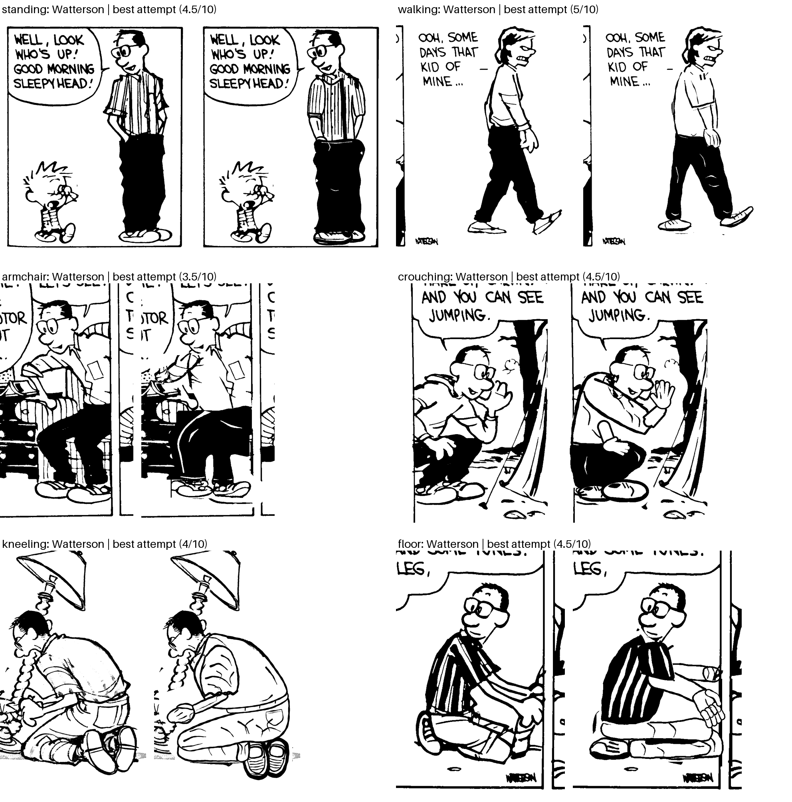

# Practice drawing Dad in six poses

Six of Watterson's drawings had Dad's body erased below the head
(`tools/extensions/poses/tasks.py`). Sonnet agents drew him back in with
`ink.py` and the parts kit, without seeing the originals. A critic agent
compared each drawing against Watterson's and scored it from 0 to 10, where
5 means "clearly Dad in the right pose but obviously amateur".

Each pose got two independent first attempts: one assembled from parts-kit
cut-outs, one drawn freehand. The better one went through two
critique-and-revise rounds, and a revision was kept only if the critic
judged it better.

| Pose | Reference | First tries | After round 1 | After round 2 | Best |
|---|---|---|---|---|---|
| Standing, hands in pockets | p245-13 | 4, 3 | 4.5 | 4.5 | 4.5 |
| Walking | p186-07 | 4, 4 | 5 | 5 | 5 |
| Armchair | p054-01 | 3.5, 2.5 | 3.5 | 3.5 | 3.5 |
| Crouching | p108-05 | 4, 3.5 | 4 | 4.5 | 4.5 |
| Kneeling, soles up | p008-01 | 4, 3 | 4.5 | 4 | 4 |
| Sitting cross-legged | p110-11 | 2.5, 3.5 | 4 | 4.5 | 4.5 |

Each round moved the best score by half a point at most. The critic's own
noise is about that size: it scored the same unchanged drawing 4 in one
round and 5 in the next. **Revising whole figures has plateaued at 4–5.**

## The same three failures everywhere

The critics' worst problems were the same in every pose:

1. **Hands read as mittens:** too big, with parallel finger ticks and no
   gesture. Watterson's hands are small and compact, with a thick outer
   contour, and they grip or droop.
2. **Shoes read as ovals or slippers.** Watterson's are long, lumpy
   sneakers with a heavy sole, a tongue, laces and a rounded toe cap, angled
   to the floor. Soles turned up towards us are tilted and overlapping.
3. **Folded legs read as sausages or a blob.** Standing and walking legs
   came out acceptably. Seated, crouched and kneeling legs lost the knee: no
   decisive thigh angle, no bunching at the shin and cuff, and folds in
   tidy repeating ticks.

These are the parts panel 2 needs most.

## What worked (agents' lessons, merged)

- **Layered outlined shapes:** fill white, then stroke a closed outline,
  drawing back to front (far limbs, trousers, shoes, torso, sleeve, forearm,
  hand). Later white fills cover earlier lines, so overlaps resolve like
  drawn depth.
- **Outlined tubes:** a wide black stroke with a narrower white stroke on
  top gives a constant-weight outline and clean bends.
- **Black trousers:** thick tapered strokes along hip, knee and ankle, plus
  a rounded fill at the knee and seat. Add a few short tapered white strokes
  only at the knee, seat and cuff, and a white wedge between the legs. Next
  to black furniture, a thin white rim keeps the knee readable.
- **Weight hierarchy:** about 0.035–0.04 Hw for outlines and 0.08 Hw for
  soles, hems and the shadow-side back contour. Uniform weight looks
  mechanical.
- **Shirt and sleeves:** keep the torso about 1 Hw wide, with sloped
  shoulders and sleeves narrow at the shoulder and a straight hem. Draw the
  forearm before the sleeve so the hem overlaps it. Stripes, when the
  reference has them, are sparse, tapered and follow the form.
- **Light trousers** (p008, p110): white with an outline and a few long,
  straight, decisive folds, not black.
- **Parts kit cut-outs** were usually worse than drawing:
  - they carry neighbouring ink and crop edges;
  - their interiors are transparent, so they must be filled white first;
  - their orientation rarely matches.

  Agents that used them had to clean them by hand.
- **Zoom in.** Read 2× crops of hands, shoes and knees after every pass;
  the full view hides their problems.

## What this suggests

Each agent rebuilt shoes, hands and legs from scratch, and each made the
same mistakes. The next step is shared, reusable part builders: a shoe in
side, front and sole views, a hand in a few gestures, and a bent trouser leg
with knee and cuff. Each part should be practised in isolation against many
of Watterson's examples until it scores well, and then the poses redrawn
with them.

The best scripts are kept beside each pose's drawing here. They read their
task from a scratch directory: rebuild one with `tasks.py`.
